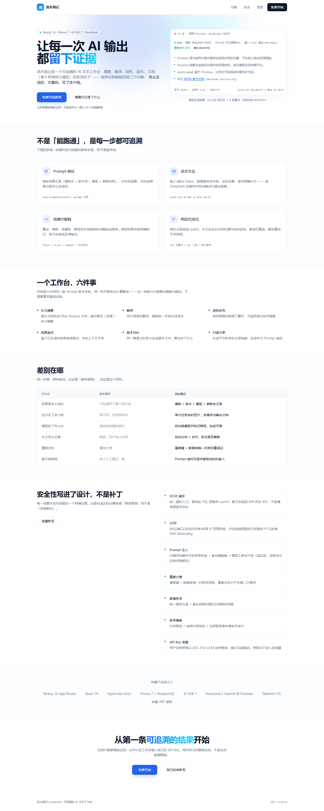
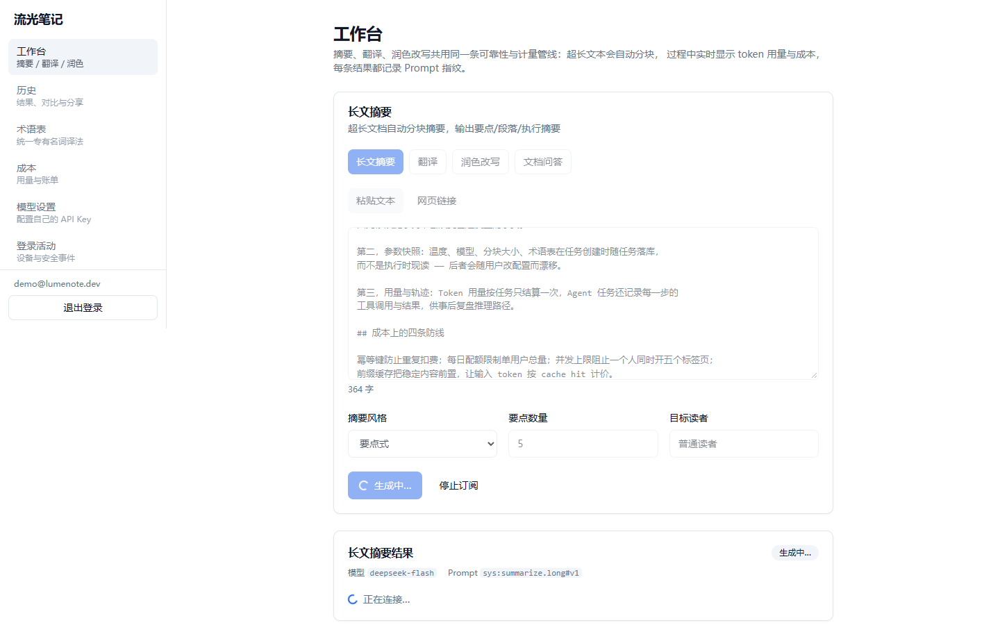
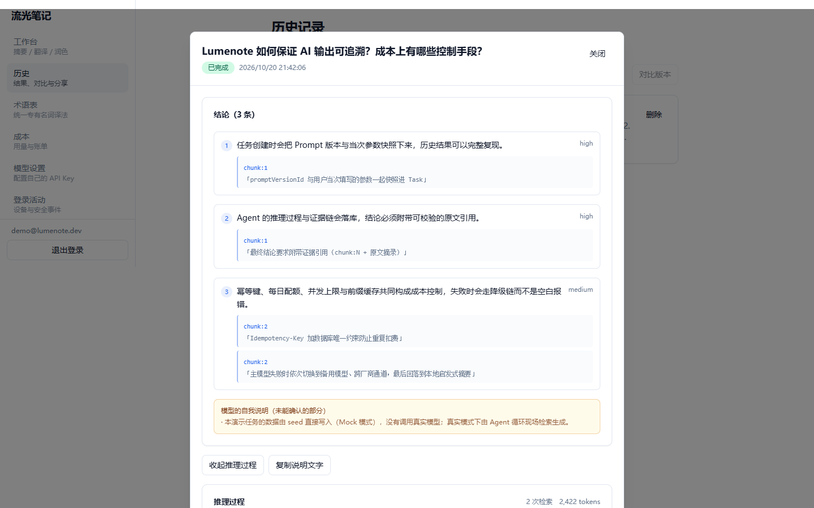
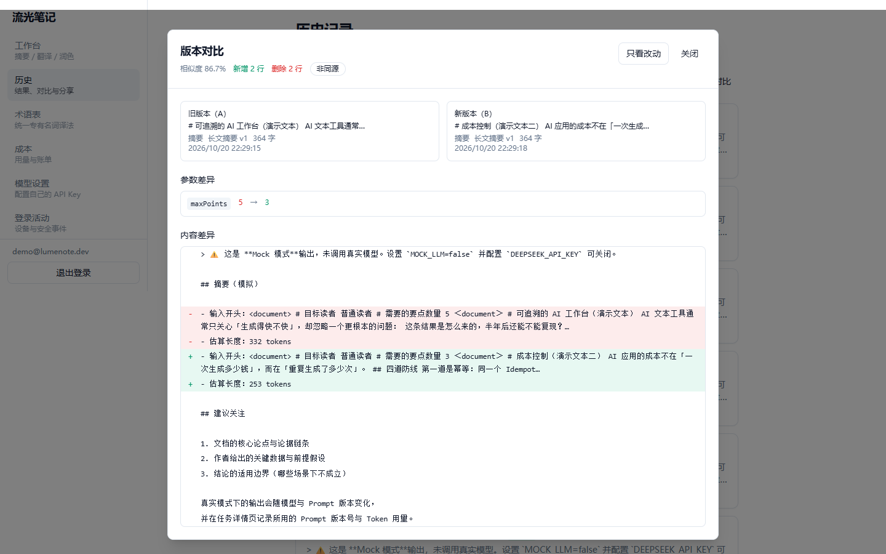

# Lumenote（流光笔记）

> 一个**可追溯**的 AI 文本工作台：摘要 / 翻译 / 润色 / 文档问答共用同一条
> 「Prompt 版本快照 + Token 计量 + 降级」管线。它和「套个壳调用大模型」的区别，
> 在于每一步都留下证据，并且**每个结论都标注了验证状态**。



---

## 这个项目想解决什么

市面上的 AI 文本工具几乎都停在「能跑通」：结果好坏不知道、为什么这样写不知道、花了多少钱不知道。

Lumenote 的每条结果都能回答三个问题：

| 问题 | 答案在哪 |
|---|---|
| 这条结果是怎么生成的？ | Prompt 指纹：模板名 + 版本号 + 模型 + 参数快照 |
| 它可靠吗？ | 降级标记、重试轨迹、证据链（Agent）、耗时与首字延迟 |
| 花了多少钱？ | 输入/输出 token、缓存命中率、峰谷计价、任务级成本 |

**3 分钟演示脚本**见 [docs/demo-script.md](docs/demo-script.md)；
**面试可讲的取舍**见 [docs/interview-guide.md](docs/interview-guide.md)。

---

## 验证状态（先看这一节）

> 核对于 **2026-10-21**，Windows 11 + Node v22.22 / pnpm 10.33.2 / PostgreSQL 16 /
> Docker Desktop 29.9.1（WSL2 后端）。数字以 **GitHub Actions 上的实跑日志**为准，
> 不用本地跑结果顶替（本地 Vitest 会因环境沙箱写缓存报 `EPERM`，见文末「已知限制」）。
> 原则：**没跑过的验证不写成"已通过"**，只写「未运行」并给原因。

| 项目 | 命令 | 本次实测结果 | 状态 |
|---|---|---|---|
| 单元测试 | `pnpm test` | 32 文件 / **662 测试**全部通过 | ✅ 已运行（CI） |
| 集成测试 | `pnpm test:integration` | 8 文件 / **23 测试**（真实 PostgreSQL 容器 + `next dev`） | ✅ 已运行（CI） |
| 覆盖率 | `pnpm test:coverage` | statements **52.4** / branches **83.38** / functions **73.63** / lines **52.4**；阈值 41/82/71/41 | ✅ 已运行，退出码 0（只统计 `src/lib/**`，见测试章节口径说明） |
| 生产构建 | `pnpm build` | 29 条路由（`Route (app)` 表）+ `ƒ Proxy (Middleware)`；无 middleware 弃用警告 | ✅ 已运行 |
| 端到端冒烟 | `pnpm smoke` | Mock 模式 **28 断言**全部通过（登录→建任务→SSE→幂等重放）；脚本**强制** `MOCK_LLM=true` 并清空三家厂商 Key，永不产生真实费用 | ✅ 已运行 |
| 评测报告 | `MOCK_LLM=true pnpm eval:report` | Mock 模式生成 [docs/eval-report.md](docs/eval-report.md) | ✅ 已运行（**不代表真实模型质量**） |
| standalone 产物 | `verify-standalone.mjs` | 按镜像布局 `node server.js`，**20/20** 断言，`/api/health` 200 且 `db.ok=true` | ✅ 已运行 |
| Docker 构建/编排 | `docker compose build` / `run --rm migrate` / `up -d app` | 镜像 `lumenote-app:local` **309 MB**，不含 dev 工具链（`vite`/`vitest`/`eslint`/`typescript` 均不存在），仅 6 个被 Next 追踪的源文件（80 KB）；**8 个迁移全部应用**；`/api/health` 200 `db.ok=true`；库内 23 表 + `vector 0.8.7` | ✅ 已运行（WSL2 + Docker Desktop 实测，详见 [docs/ops/repo-and-deploy.md](docs/ops/repo-and-deploy.md)） |
| 真实 Redis 限流 | `pnpm test:redis` | **12 项检查全过** | ✅ 已运行（三处：本机 Redis 3.2、容器 `redis:7`、CI service） |
| GitHub Actions | `CI` / `Docker Publish` | 5 个 job 全绿（verify / integration / coverage / secret-scan / rate-limit-redis）；`dependency-review` 仅在 PR 上运行 | ✅ 已运行（[Actions](https://github.com/zhouzhouman/lumenote/actions)），镜像已推送 GHCR |
| 真实模型评测 | `pnpm eval:report`（MOCK_LLM=false） | — | ❌ 未运行（无 Key、明确零费用；judge 未校准） |

> 为什么把这张表放最前面：这个项目最值得讲的是「**区分已验证与未验证**」的工程习惯。
> 面试时被问「Docker 跑过吗」，现在的回答是「跑过，六步都跑通了，包括一次性迁移和健康检查」；
> 被问「真实模型效果如何」，回答是「**没测过**——本地 `MOCK_LLM=true`、Key 已移出仓库，
> `docs/eval-report.md` 是 Mock 链路的产物，不代表模型质量」。两者都不含糊。

**截图均为真实运行截图**（Mock 模式 dev server + 系统 Chrome 渲染，非设计稿）：
生成脚本 [scripts/demo/capture-screenshots.mjs](scripts/demo/capture-screenshots.mjs)，
用 Playwright 驱动已安装的 Chrome（本机 Playwright 自带 Chromium 下载不可达，改用系统浏览器）。
复现时注意 dev server 要绑 `127.0.0.1`（`pnpm dev -- -H 127.0.0.1`），否则 Next 会拦截跨 origin 的
dev 资源导致 hydration 失败；脚本只截 Mock 输出，并会校验页面里出现「Mock 模式」标记后才继续。

---

## 快速开始（Mock 模式，不需要 API Key）

```bash
# 1. 依赖（不要随意改 lockfile）
corepack enable
pnpm install --frozen-lockfile
pnpm prisma:generate      # 生成 Prisma Client：全新克隆必须执行，否则 seed/dev 会报 client 未初始化

# 2. 先创建环境变量（顺序很重要：docker compose 会在解析阶段校验 AUTH_SECRET，
#    若此时还没有任何 env 来源，`docker compose up` 会直接报 AUTH_SECRET 未设置）
cp .env.example .env.local
#    至少要改 AUTH_SECRET：openssl rand -base64 32
#    .env.example 默认 MOCK_LLM="true"，无需任何 Key 即可完整演示
#
#    ⚠️ compose 默认读取同目录下的 `.env`（不是 `.env.local`）。二选一：
#      cp .env.local .env
#      # 或：docker compose --env-file .env.local up -d postgres redis
#    （`.env` 与 `.env.local` 都已在 .gitignore 中，不会入库）

# 3. 数据库（有 Docker）；没有 Docker 见下方「无 Docker 的本地数据库」
docker compose up -d postgres redis

# 4. 迁移 + 演示数据（幂等，可重复执行）
pnpm prisma:deploy       # 生产/本地应用迁移；不要用 prisma:migrate（开发期交互式迁移）
pnpm prisma:seed         # 内置 Prompt 模板 + 演示账号 demo@lumenote.dev / Lumenote2026!

# 5. 启动
pnpm dev                 # http://localhost:3000
```

> ⚠️ **演示账号是固定开发密码，只用于演示环境**。`pnpm prisma:seed` 写入的
> `demo@lumenote.dev / Lumenote2026!` 拥有已知凭据；**生产环境不要执行这个 seed**，
> 或执行后立即删除/改密该账号，否则等于给公网留了一个已知口令的后门。

### 无 Docker 的本地数据库（可复制的建库命令）

本机已有 PostgreSQL 16 在 `127.0.0.1:5432` 时，用超级用户执行一次：

```bash
# 创建应用角色与库（.env.example 的 DATABASE_URL 默认就是这组值）
psql -U postgres -c "CREATE ROLE lumenote LOGIN PASSWORD 'lumenote';"
psql -U postgres -c "CREATE DATABASE lumenote OWNER lumenote;"

# 集成测试还需要独立的测试库（harness 会 DROP 该库的 public schema，绝不能指向开发库）
psql -U postgres -c "CREATE DATABASE lumenote_test OWNER lumenote;"
```

- 执行等价 SQL 即可，不要求一定装 `psql`（任何 PG 客户端/管理工具都行）；
- 若用便携版/自建实例：`initdb` 初始化数据目录、`pg_ctl start` 启动后，
  用 `PGHOME` / `PGDATA` / `PG*` 告诉 `scripts/dev.mjs`（见 [docs/demo-script.md](docs/demo-script.md) §5）；
- 数据库地址必须与 `.env.local` 的 `DATABASE_URL` / `DIRECT_URL` 一致。

**让 `pnpm dev` 自动拉起本地/便携版实例**（它探测到数据库没在跑就会自己启动）：

```powershell
# ⚠️ PGHOME 必须指向「含 pgsql/bin（或 bin）与 pgdata（或 data）」的目录
$env:PGHOME = 'C:\path\to\postgresql'
pnpm dev
```

> **`scripts/dev.mjs` 不读 `.env.local`**，它只看进程环境变量 —— 所以 PGHOME 写在
> `.env.local` 里是无效的。要么每次 `$env:PGHOME=...`，要么用 `setx PGHOME "..."`
> 写进用户环境变量（需重开终端生效）。
>
> 不设 PGHOME 且 Docker 不可用时，它会在探测阶段明确报错退出，**不会假装数据库可用**：
> `未设置 PGHOME，检测到 docker —— 回退到 docker compose …` → `docker compose up -d postgres 执行失败`。

登录演示账号后即可体验全部能力；Mock 模式的输出顶部会明确标注
「这是 **Mock 模式**输出，未调用真实模型」——不伪装成真实结果。

- **想用真实模型**：`.env.local` 里设 `MOCK_LLM="false"` 并配置 `DEEPSEEK_API_KEY`；
  或登录后在「模型设置」填入自己的 Key（BYOK，不占站点配额）。
- **改了 `prisma/seed.ts` 的 Prompt 模板**：必须重跑 `pnpm prisma:seed` ——
  模板在数据库里，不是代码常量；历史任务引用的是具体版本行。

---

## 技术栈

- **框架**：Next.js 16（App Router）+ React 19 + TypeScript strict
- **数据**：Prisma 7 + PostgreSQL 16
- **样式**：Tailwind CSS 3.4（CSS 变量驱动，支持暗色）
- **模型接入**：AI SDK 7 + `@ai-sdk/openai-compatible`（DeepSeek 主 / OpenAI 备 / 本地 Mock）
- **鉴权**：自建 JWT（access 15min + refresh 7 天轮换）+ bcrypt + 邮箱验证码
- **限流**：store 抽象，`memory`（默认）/ `redis`（多实例共享）
- **可观测性**：OpenTelemetry tracing（JSONL / OTLP exporter）+ 数据库指标聚合
- **测试**：Vitest 2（32 文件 / 662 单测）+ 真实 Postgres 集成测试（8 文件 / 23 测试）+ Playwright 截图脚本

---

## 架构速览

### 两段式流式（核心设计）

```
POST /api/tasks             →  立即返回 taskId（实测 < 200ms），after() 异步跑管线
GET  /api/tasks/:id/stream  →  SSE 订阅输出，可断线重连（Last-Event-ID）
```

**为什么不做一个请求流式返回？** Serverless 有执行时长上限，长文 Map-Reduce 可能跑几分钟；
更关键的是**断线可重连** —— 内容与状态在数据库里，服务重启也不丢。

⚠️ `after()` **不是队列**：没有持久化、重试、租约、死信；崩溃会留下 `running` 任务。
单实例常驻下可用，Serverless 只适合短任务，多实例需要外部队列。完整边界见
[docs/adr/0005-async-execution-boundary.md](docs/adr/0005-async-execution-boundary.md)。

### 一张图看全



（完整系统架构图、时序图、Agent 状态机、ER 图见 [docs/architecture.md](docs/architecture.md) 的 §九–§十二。）

### 可靠性四层

```
错误分类重试（仅 retryable）→ 熔断 → 降级链 → 用户体验永不空白
```

降级链：`deepseek-flash` → `deepseek-v4-pro` → `openai` → 本地启发式摘要。
**降级产出的结果会被明确标记（`degraded=true`）**，不伪装成正常输出。
熔断器是**进程内存**实现，多实例不共享（已知限制）。

### Agent：控制权在代码

- 状态机由代码驱动：`plan → act → observe → finalize / give_up`；
- 双预算（步数 + token）、单工具额度、重复调用检测（第 3 次强制收敛）；
- **工具全部只读**（Prompt 注入的真正防线）；
- 结论必须带 `chunk:N` 证据，`checkEvidence()` 做确定性校验（引文是否真在分块里）；
- ⚠️ 模块拆分口径：`loop.ts` 只有 **43 行 re-export 门面**，真实状态机在
  `orchestrator.ts`（约 570 行）。「968 → 43」只描述门面行数，**不代表复杂度下降了 90%**，
  实际收益是职责分离与可测试性（各模块有独立单测）。



---

## 能力：一个工作台

所有能力**共用同一条可靠性与计量管线** —— 加一种能力只需在
[src/lib/tasks/types.ts](src/lib/tasks/types.ts) 加一条定义 + 在 seed 里加模板，
工作台 UI、路由、计量都不用改。

| 能力 | 分块 | 说明 |
|---|---|---|
| 长文摘要 | ✅ Map-Reduce | 超长文档自动分块、逐块摘要、合并；Map 阶段不推流，Reduce 流式输出 |
| 翻译 | ❌ 整篇 | 带术语表强制统一译法。**刻意不分块**：切开后人称、语气、术语会前后不一致 |
| 润色改写 | ❌ 整篇 | 三档强度 + 目标风格，保持原意与段落结构 |
| 文档问答（Agent） | 工具检索 | 自主检索文档并给出带证据引用的结论；Mock 模式不支持工具（见已知限制） |
| 结果追问 | ❌ | 基于已生成结果继续提问，父子任务关联（`parentTaskId`），可多轮 |
| 版本对比 | — | 任意两条记录的逐行 diff + 参数差异 |
| 只读分享 | — | 不可枚举 token，只分享结果不分享输入 |
| 成本与用量 | — | 任务级 token / 缓存命中 / 峰谷 / 成本 |

### 版本对比（Diff）



- **接受任意两个 taskId**：真实需求里经常对比不同参数（要点式 vs 段落式）甚至不同能力的结果；
- **两次都走 `authzTask`**：只校验一个是典型疏漏（拿自己的当 a、别人的当 b 就能读别人输出）；
- 除内容 diff 外给出**参数差异**（换了模型？改了要点数？）；
- 自研 LCS（[src/lib/tasks/diff.ts](src/lib/tasks/diff.ts)），行数积超过 10^6 时退化为整体替换并标 `truncated`。

### 追问对话链

```
POST /api/followup   { parentTaskId, question }  → 新建追问子任务
GET  /api/followup?taskId=...                    → 直接子任务列表
GET  /api/followup?taskId=...&whole=1            → 整条对话链
```

- 向上找根再从根展开（入口可能来自链上任意一环）；
- 展开用**逐层 BFS** 而不是只查一层 —— 只查一层会让「追问的追问」静默消失；
- 上下文只带「上一轮结果 + 本轮问题」，避免成本随轮次线性增长；
- **成本保护与任务创建一致**：追问同样检查每日配额、并发上限与按用户限流；
  BYOK 判定以父任务的 `credentialId` 快照为准（用自己 key 的追问不占站点配额）；
  ⚠️ 但追问目前**没有幂等键**，双击/网络重试会重复建子任务并重复计费（见已知限制）。

### 批次处理（面向内部文档流水线）

一批材料一起交、串行跑、逐条留痕、可导出 —— 面向「合同/标书/研报批量处理」这类
**内部**场景：材料不方便传到外部 SaaS，但确实需要批量 + 可审计 + 花费可预测。

- **输入**：一个文本框，多份之间用单独一行 `---` 分隔；某一整块是链接时按网页读取
  （走同一套 SSRF 防护）。刻意不做文件上传 —— PDF/DOCX 解析是另一个量级的工作，
  而内部材料的实际来源往往是邮件/IM/Word 里复制出来的文本；
- **串行执行**：批次内按 `batchOrder` 一条一条跑。串行不是偷懒：
  「同用户同时 1 个进行中任务」本来就是既有约束，而且**预算是「花到上限就停」**，
  并发跑会让闸门在起跑瞬间失效；
- **预算闸门**：设了上限后，每条**发请求之前**先估算下一条会不会超。
  超了就把剩余条目置为 `canceled` + `SKIPPED_BUDGET` —— 它们**没有花钱**，
  与「失败」严格区分（把跳过算进失败会让失败率失真，用户会去排查不存在的模型问题）。
  ⚠️ 预算是**软上限**：实测预算 ¥0.0025 时最终花了 ¥0.0029，
  偏差来自「预估 vs 真实」的最后一条，不会级联超支；
- **留痕**：每条记录都带模型、Prompt 版本、输入/输出 token、成本、耗时、是否降级、
  错误码。导出 Markdown/CSV 时会一并带上 —— 否则导出文件和「随手用网页版 AI 跑一遍」
  就没有区别，内部审计时无法自证；
- **单条失败不拖垮整批**：某份链接打不开时，该条落一条 `failed` 记录（带原因），
  其余继续跑。失败也要有记录，否则详情页会少一行，用户会以为系统在丢数据；
- **取消是合作式**：只置 `cancelRequested`，执行器在**条目边界**停下，
  不强杀正在跑的那条（强杀会留下半截输出与不完整的计量）。

### 审计留痕（内部合规）

「谁在什么时候对哪些数据做了什么」—— 回答不了这个问题的系统，进不了合规流程。

与 `SecurityEvent` 的分工：SecurityEvent 管认证侧（谁试图登录、失败几次），
AuditLog 管业务侧（谁跑了批次、导出了什么、改了凭证、开了分享）。

记录的动作：`batch.create` / `batch.cancel` / `batch.export` /
`credential.create` / `credential.update` / `credential.delete` /
`share.create` / `share.revoke` / `audit.export`。

三个**数据层**决定（不是应用层约定）：

- **`userId` 可空 + `actorEmail` 快照**，外键 `ON DELETE SET NULL`。
  删掉一个账号时，他做过的操作不能跟着消失 —— 出事时最先要查的恰恰是
  「离职/被删账号做过什么」。真正的那个人靠邮箱快照记住；
- **没有 `updatedAt`、没有 `deletedAt`**，系统也**不提供任何修改/删除审计的接口**。
  审计的价值全在「谁都改不了」，一旦给了入口，哪怕只给管理员，证明力就打折；
- **`meta` 写入前过一层键名黑名单**（password / secret / token / apiKey /
  authorization / cookie / 验证码…），递归剔除 + 字符串截断。
  导出会发给外部审计方，密钥跟着导出文件流出的错误在 code review 里几乎看不出来。

可见性：`User.role = 'auditor'` 能看到全员日志，其他人只看自己的。
⚠️ 这**不是 RBAC** —— 只有一个读权限位，凭据见 `schema.prisma` 里的说明。

导出 CSV / JSON，单次上限 5000 条，且**导出动作本身也会被记一条**：
只记「谁看了业务操作」却不记「谁把这些记录拷走了」，是自相矛盾的。

### 只读分享 / 术语表 / 登录活动

- **只读分享**：32 字节密码学随机 token（不可枚举）；未撤销 + 未过期 + 任务未软删，四条约束缺一不可；
  分享页**只展示结果不展示输入正文**；
- **术语表**：创建任务时快照进 `Task.params.glossary`，改术语表不影响历史任务（否则不可追溯）；
- **登录活动**：用户自查工具（时间 + IP + 设备），配套活跃会话列表与踢出 ——
  改密码只能阻止未来登录，已登录会话必须显式销毁。

---

## 成本控制

DeepSeek 的定价有三个维度，缺一不可：

1. **缓存分档**：flash 模型 cache hit 是 miss 的 **1/50**（$0.003 vs $0.15）
2. **峰谷分时**：高峰为低谷的 **2 倍**
3. **输入输出不同价**：输出约为输入 miss 的 **4 倍**

因此 `render.ts` 把**稳定内容前置**以命中前缀缓存 —— 这个顺序直接决定成本，
不是风格问题。计价逻辑见 [src/lib/llm/pricing.ts](src/lib/llm/pricing.ts)
（含峰谷判定与中国法定节假日表，核对日期 2026-10-11）。

除了计价，还有三道成本闸门，**覆盖所有会真实调用模型的创建路径**
（`POST /api/tasks`、`POST /api/agent`、`POST /api/followup`）：

1. **幂等键**：tasks / agent 走 `Idempotency-Key` + 数据库唯一约束；
   ⚠️ 追问（followup）目前没有幂等键，双击/网络重试会重复建子任务并重复扣费（见已知限制）；
2. **每日配额**：按任务数计；BYOK 用户不占站点配额（追问以父任务的 `credentialId` 快照判定）；
3. **并发上限 + 按用户限流**：同一用户同时 1 个进行中任务；追问与新建任务用同一维度限流。

已知限制：配额是「先查后写」，并发提交理论上可绕过，靠并发上限与限流把窗口压小；
`RATE_LIMIT_PER_MINUTE`（全局限流）当前**未接入路由**，不要当成已生效的控制。

---

## 安全设计

| 风险 | 防御 |
|---|---|
| **IDOR 越权** | `authzTask` 等统一入口，SQL 层带 `userId` 过滤；查不到返回 404 而非 403 |
| **SSRF** | 协议/端口/白名单/DNS 解析后私网 IP 四层校验，**连接层固定已校验 IP**，重定向逐跳复验，云元数据地址硬编码拦截 |
| **Prompt 注入** | 分隔符包裹 + 中和结束标签 + 输出侧脱敏 + **LLM 工具全只读** |
| **重复计费** | `Idempotency-Key` + `Task @@unique([userId, idempotencyKey])` 双保险；`UsageLog.taskId @unique` 一次结算。⚠️ 幂等键会先清洗字符集，**清洗后为空时回退随机 UUID**（否则所有请求都命中 `(userId, '')`，从第二条起会被静默当成「重放」返回第一条任务） |
| **邮箱枚举** | 统一错误文案 + 真实 cost-12 哈希的假 bcrypt 比对消除时间差 + 发码接口响应完全一致 |
| **账号爆破** | 限流（memory/redis）+ 失败锁定（落库，多实例一致）+ 安全事件审计 |
| **Token 失效** | refresh token 服务端轮换，登出即销毁 session（不只是清 cookie） |
| **用户 API Key 泄露** | AES-256-GCM 加密落库（密钥派生自 `AUTH_SECRET`），接口只回掩码 |
| **开放重定向** | 登录后 `next` 参数用 URL 解析比 origin，挡住 `//evil.com` 与 `/\evil.com` |

### 安全边界（必须诚实）

- **`proxy.ts` 不是安全边界**：它只做「cookie 是否存在」的乐观检查，
  真正的鉴权在每个 API 路由（`requireUserId` → 验签 → 查 DB）。Next 16 起
  `middleware` 文件约定被 `proxy` 取代，且 Proxy 固定跑 Node runtime；
- **CSP 目前是 Report-Only**：`script-src` 含 `unsafe-inline`、无 nonce；
  HSTS 仅生产发送且依赖反代终止 TLS；
- **限流 IP 来自 `TRUST_PROXY_HOPS`**：默认 0 不信任 `X-Forwarded-For`（防伪造）。
  ⚠️ **默认 0 的代价必须知道**：所有请求共享同一个 `unknown` 限流桶 ——
  攻击者只要打满全局 auth 桶（login 30 次/5 分钟、register + verification 5 次/5 分钟），
  **所有人都无法登录/注册**（429），相当于一个低成本的全局拒绝服务面。
  直连暴露在公网时**必须保持 0**（否则客户端可自写 XFF 绕过限流）；
  部署在反向代理后按真实层数设置，并保证应用端口只对代理开放。
  `docker-compose.yml` 默认把 3000 端口发布到宿主 —— 生产部署者要有「端口是否真的暴露」的意识；
- **Redis `fail-open` 的延迟代价**：Redis 挂死（不是拒绝连接，而是 TCP 无响应）时，
  每个请求可能先等 `connectTimeout`（2s 量级）才降级到内存限流。
  fail-open 保的是**可用性**，不保低延迟；对延迟敏感时用 `closed`（直接 429）或调小 connectTimeout；
- **熔断器仍是进程内存**，多实例不共享（限流已可 Redis 共享）。

> ⚠️ prompt 注入没有彻底解法。护栏只降低概率，真正的防线是不给模型写权限的工具与数据隔离。
> 本项目**不是安全审计**，以上只是工程取舍。

---

## 移动端与可访问性（静态检查，未做真实设备验证）

只做了**读代码级**的静态检查，没有用真实移动设备、屏幕阅读器或 Lighthouse 验证过。
以下结论都按「看到什么写什么」记录，不把静态检查说成无障碍达标。

**已有的**：

- 错误提示统一 `role="alert"`（登录表单、历史、设置、安全活动、成本页等 6 处）；
- 两个弹窗（历史详情 / 版本对比）都有 `role="dialog" + aria-modal="true"` 与「关闭」按钮；
- Tabs 组件有 `role="tablist" / tab / tabpanel` 与 `aria-selected`；
- 交互元素使用 `focus-visible:ring`（4 个 UI 基础组件），键盘焦点可见；
- 响应式：落地页与网格布局使用 `sm:/md:/lg:` 断点（窄屏下三列表格会换成卡片，理由见代码注释）；
- `prefers-reduced-motion: reduce` 下入场动画降级（`globals.css`）；
- Agent 时间线用原生 `<details>/<summary>`，自带键盘可达性与无障碍语义。

**发现的缺口（均为静态阅读结论，本轮未改 `src/**`）**：

1. 工作台的主输入框只有 `placeholder`、没有 `<label>`/`aria-label` —— 占位文本不是可访问名称，
   读屏用户不知道这个多行输入框叫什么；
2. 工作台顶部的「长文摘要 / 翻译 / 润色改写 / 文档问答」是一排普通按钮，
   没有 `role="tablist"` / `aria-selected` / `aria-pressed`，视觉上像标签页但语义不是；
3. SSE 流式输出没有 `aria-live` 区域，读屏用户不会被告知内容在增长；
4. 配色对比度没有做量化检查；`text-muted-foreground` 在部分浅色底上的对比度需要实测确认；
5. 只截了 1440×900 的桌面截图，**没有做 390px 移动端仿真/真机验证**。

这些属于 `src/**` 改动（本轮范围外），已作为变更请求交给 Lead，而不是在文档里假装已达标。

---

## 用自己的 API Key（BYOK）

工作台 →「模型设置」可以填入自己的模型 API Key，用**自己的额度**生成内容。

| 关注点 | 做法 |
|---|---|
| 密钥存储 | AES-256-GCM 密文，密钥由 `AUTH_SECRET` 经 scrypt 派生；不存明文 |
| 密钥读取 | 接口只返回掩码（`sk-…a1b2`）；密文也不回传前端 |
| 任务追溯 | 任务只记录 `credentialId`，绝不把密钥写进任务参数或日志 |
| 自定义端点 | 允许中转网关，但内网/环回/云元数据地址一律拦截；非本机必须 https |
| 失败行为 | 用户凭证失败时**不会静默改用站点 Key** —— 明确标记降级并说明原因 |
| 配额 | 用自己的 Key 不占站点免费配额；但**并发上限仍生效**（保护用户自己的钱包） |

验收脚本（不产生真实模型调用，需先 `pnpm dev`）：

```bash
node scripts/verify/byok.e2e.mjs
```

---

## 测试与质量

| 命令 | 做什么 | 环境要求 | 本次是否运行 |
|---|---|---|---|
| `pnpm test` | 单元测试（纯逻辑，不连库/不联网） | 无 | ✅ 662 全过（CI） |
| `pnpm test:integration` | 真实 Postgres + 真实 HTTP 集成测试 | PostgreSQL 16 测试库；**先停掉 dev server**（Next 16 每项目只允许一个 dev server） | ✅ 23 全过（CI） |
| `pnpm test:coverage` | 单测 + 覆盖率（只统计 `src/lib/**`） | 无 | ✅ 52.4 / 83.38 / 73.63 / 52.4，阈值 41/82/71/41，退出码 0 |
| `pnpm test:redis` | 真实 Redis 限流验证（Lua 原子性 / TTL） | 可达 Redis | ✅ 12 项通过（本机 3.2 / 容器 7 / CI 均验过） |
| `pnpm smoke` | 端到端冒烟：登录→建任务→轮询→SSE→幂等重放 | PostgreSQL；自动起 dev server（3200）；脚本强制 Mock 并清空厂商 Key，**不产生真实费用** | ✅ 28 断言 |
| `MOCK_LLM=true pnpm eval:report` | 生成评测报告 + trace | PostgreSQL | ✅ 仅 Mock 模式 |
| `node scripts/docker/verify-standalone.mjs` | standalone 产物按镜像布局验证 | 先 `BUILD_STANDALONE=true pnpm build` | ✅ 20/20 |
| `pnpm check` | typecheck + lint + test | 无 | ✅ |
| `pnpm verify:all` | prisma validate + typecheck + lint + test + build | 无 | ✅ |

接口层验收脚本（需先 `pnpm dev`，均为 Mock/开发环境）：

```bash
node scripts/verify/features.e2e.mjs   # 分享/追问/版本对比/术语表/登录活动
node scripts/verify/byok.e2e.mjs       # BYOK：CRUD / 越权 / 密钥不泄露 / 管线联通
npx tsx scripts/verify/auth-seed.ts > scripts/verify/.auth-seed.json
node scripts/verify/auth.e2e.mjs       # 认证：验证码 / 防重放 / 枚举防护 / 锁定
```

> 三个已知的「测试环境坑」：
> 1. **每日配额会被跑光** —— 验收会真实创建任务，先用 `npx tsx scripts/verify/topup-quota.ts` 调高配额；
> 2. **注册/发码共用单 IP 限流桶** —— 连续重跑会撞限流，重启 dev server 即清空（内存 driver）；
> 3. **这些脚本依赖 `MAIL_TRANSPORT=console` 回传 `devCode`**，只在非生产环境可用。

### 测试抓住了什么（真实 bug）

单测覆盖的是「纯逻辑且容易算错」的部分：分块边界（丢内容）、计价分档（算错不报错）、
SSRF 私网判定（等价写法绕过）、护栏脱敏（正则 `lastIndex` 状态）、退避抖动（惊群）、
模板渲染（默认值回落）、Markdown 解析（流式半成品、链接安全）、凭证加解密与地址校验、
限流 store 与客户端 IP 解析、observability 脱敏与配置降级。

几个真实 bug 就是被这些测试逼出来的：

- 分块时「单位接近上限」的判断写在追加之后，导致产出超过 `maxTokens` 的块；
- `renderTemplate` 直接读 `values` 而未走 `resolved`，`default` 永远不生效；
- 零宽字符正则因写字面字符被识别成连字符，会把正文里所有 hyphen 删掉；
- `withRetry` 只在 backoff 期间检查 `AbortSignal`，用户点「停止」后第一次请求仍会真实扣费；
- SSE 断线重连时服务端从头重放、客户端又追加，内容翻倍（集成测试锁定「拼接后逐字一致」）。

还有一类**运行环境测试**（`tests/ssr-safety.test.tsx`）：在无 `window` 的环境里真的渲染一次
客户端组件 —— `tsc` 与 ESLint 都不做运行环境检查。

### 覆盖率为什么只有 ~52%

覆盖率只统计 `src/lib/**` 的纯逻辑，**不包含路由、页面、SSE、数据库路径** ——
这些由集成测试覆盖。所以 52% 不代表产品整体验证程度，也不要把数字当质量结论。

阈值是防倒退用的（**41/82/71/41**，2026-10-20 按当时基线向下取整）。
当前实测已涨到 **52.4 / 83.38 / 73.63 / 52.4**，`pnpm test:coverage` **退出码 0**。
阈值刻意**没有跟着上调**：上调会让 CI 门禁更紧，需要单独评审（避免因为一次波动的运行
就把 main 卡住）。要涨的话按 `vitest.config.ts` 注释里的约定取整即可。

---

## 评测与可观测性

- 评测框架：数据集 / 用例 / 运行 / 结果 / judge 校准表；规则断言（contains / regex / JSON /
  证据链 / 工具使用 / 死循环 / 步数）+ 可选 LLM judge；
- 报告：[docs/eval-report.md](docs/eval-report.md)，由 `MOCK_LLM=true pnpm eval:report` 生成。
  **它是 Mock 模式**：MockProvider 输出固定占位文本，规则断言失败是预期的（恰好证明断言有区分力）；
  报告中的通过率 / 延迟 / 成本**不代表真实模型质量**；
- **judge 未运行、人工校准未做**；失败样本回归集 8/8 检出 + 2/2 对照组通过，证明断言有区分力；
- 可观测性：任务级 OTel trace，`taskId` 贯穿 `task.pipeline / llm.request / agent.*`，
  默认 JSONL 落盘**系统临时目录**（`<tmp>/lumenote-traces`，可用 `TRACE_DIR` 覆盖；刻意不放在项目内，避免 Next dev 的文件 watcher 被 trace 写入触发无限热重载）；属性脱敏不落 prompt/正文/Key。
  `TRACE_EXPORT=otlp` 需自备 Collector，**端到端未验证**。

---

## 渲染层：为什么自己写 Markdown 解析

输出容器 class 是 `prose-lumenote`，但早期渲染方式是把纯文本直接塞进 `div` ——
那些排版选择器永远匹配不到元素，模型输出的 `[标题](https://…)` 就是用户看到的一串死字符。

修复没有引 `react-markdown`，理由是**流式场景**：输出是逐字到达的半成品，
`[标题](htt` 这种片段在一瞬间是合法输入，解析器必须是纯函数、对任何残缺输入只降级不抛错。

[src/lib/markdown.ts](src/lib/markdown.ts) 的原则：**解析不出来的一律当纯文本，绝不丢字符**；
安全上只放行 `http/https/mailto`，相对路径与 `javascript:` 一律拒绝（模型输出等价不可信输入）。

---

## Non-goals（明确不做的事）

- **不做多用户协作** —— 单用户工具，共享只到「只读分享链接」这一层；
- **不做向量检索 / RAG** —— `KnowledgeChunk` 表预留了 pgvector 字段，本期不实现检索；
- **不做移动端 App** —— Web 响应式够用；
- **不做自建 LLM 网关** —— 用 AI SDK 的 Provider 抽象，不重复造轮子；
- **不做实时协同编辑** —— 与核心定位（可追溯的单次生成）无关。

---

## 已知限制（当前真实状态）

1. **`after()` 不是队列**：进程崩溃会留下永久 `running` 任务，无 reaper / 租约 / 重投；
   执行中不落增量输出，崩溃后已生成内容丢失。详见 [ADR-0005](docs/adr/0005-async-execution-boundary.md)。
2. **熔断器状态在进程内存**：多实例下各实例独立打开熔断；限流已可 Redis 共享，但熔断没有分布式化。
3. **CSP 是 Report-Only**：`script-src` 含 `unsafe-inline`、无 nonce；HSTS 仅生产；
   `proxy.ts` 只做乐观检查、不是安全边界。
4. **配额是「先查后写」**：并发提交理论上可绕过，靠并发上限 + 限流压缩窗口；
   彻底修法是把检查与插入放进 `Serializable` 事务或用户级咨询锁。
5. **MockProvider 不支持 tools**：`MOCK_LLM=true` 时新建 Agent 任务只有 1 步 finalize、
   `structured=null`、证据 rate=0；证据演示请用 seed 的演示任务。
6. **真实模型评测仍未运行**（这是当前唯一真正没跑的一项）：
   - 无真实 Key（已移出仓库，只存在于 GitHub Actions Secret）→ `MOCK_LLM=false` 的
     评测从未执行、零费用；judge 未校准，因此**没有任何真实模型质量的结论**；
   - `docs/eval-report.md` 是 Mock 链路的产物，只证明报告生成链路可用。

   > 历史说明：2026-10-21 之前这里列的是「Docker / Redis / GitHub Actions 均未运行」。
   > 那一天补跑了这三项并全部通过，同时踩到三个环境前提，记在这里免得别人重踩：
   > ① Windows 上 Docker Desktop 依赖 **WSL2**，`wsl` 未安装时它只报
   > 「Docker Desktop is unable to start」这种无信息量的错误；
   > ② Docker 默认走**系统代理**，代理软件没启动时拉镜像会报
   > `connectex: ... connecting via static system HTTPS proxy`；
   > ③ Postgres 镜像**必须带 pgvector**（`pgvector/pgvector:pg16`），
   > 官方 `postgres:16-alpine` 会让 init 迁移以 `E0A000 extension "vector" is not available` 失败。
   > 完整步骤见 [docs/ops/repo-and-deploy.md](docs/ops/repo-and-deploy.md)。
7. **覆盖率只代表纯逻辑**：`pnpm test:coverage` 只统计 `src/lib/**`（当前约 52%），
   路由/SSE/数据库事务这些真正容易出问题的路径由集成测试覆盖；
   不要把覆盖率数字当成产品整体验证程度。
8. **更换 `AUTH_SECRET` 会导致已保存的 BYOK 密钥全部无法解密**（用户需重填）——
   加密密钥必须来自服务端，不能与密文同存；解密失败时管线退回站点通道，设置页可见失败记录。
9. **追问（`POST /api/followup`）没有幂等键**：双击或网络重试会创建重复子任务并重复扣费。
   「同一问题问两次就该跑两次」是产品语义，但网络重试属于同一意图 ——
   目前靠前端禁用按钮缓解，彻底修法是客户端传唯一键或服务端按
   (parentTaskId, question, 时间窗) 去重。
10. **`RATE_LIMIT_PER_MINUTE` 未接入路由**：`rateLimitByIp()` 当前没有调用点，
    该环境变量仅保留给限流 store / 后续接入，不要把它当作生效的全局限流；
    实际生效的是 auth 与任务创建维度的限流桶（见安全章节）。
11. **生产必须换掉 console 邮件通道**：`MAIL_TRANSPORT=console` 在生产环境不会发信、
    也不会回传验证码 → 新用户无法注册；必须用 `resend` + `RESEND_API_KEY`（smtp 未接入）。
12. **seed 的演示账号是固定开发密码**：`demo@lumenote.dev / Lumenote2026!` 只用于演示环境；
    生产不要执行 `pnpm prisma:seed`，或执行后立即删除/改密该账号。
13. **seed 对内置模板是「原地更新 v1」**：改模板文案后重跑 seed 会改写 `PromptVersion(version=1)`
    的内容，而历史任务只存 `promptVersionId` —— 严格意义上的「历史 Prompt 不可变」需要
    在文案变化时新建版本而不是 update。当前按开发期约定处理（演示库可重建）；
    生产若要求审计级不可变，应改为 seed 只插入新版本、不改旧行。
14. **批次（v1）的四条边界**：
    - **没有组织/角色模型**：所谓「团队」靠「内网部署 + 每人一个账号 + 批次归属到人」实现。
      真正的多租户（org / 成员 / 角色 / 团队配额）是另一条产品线，硬塞会把 `Batch`
      做成半成品；
    - **不支持文件上传**：只吃文本与链接。PDF/DOCX 需要引入解析依赖与二进制处理，未做；
    - **串行意味着慢**：20 份材料 × 每份几十秒 = 十几分钟。要提速的正确做法是
      「分片 + 每片独立预算」，而不是简单加并发（加并发会让预算闸门失效）；
    - **取消不打断正在跑的那一条**，且**批次没有 reaper**：与 §1 同源 ——
      `after()` 不是队列，进程崩溃会留下一个 `running` 的批次。当前靠「取消接口在
      `queued` 时直接收尾」兜住一部分，彻底修法同 §1（要真队列）。
15. **审计是「尽力而为」，不是审计级的不可篡改**：
    - **写入失败不阻塞业务**（与 `recordSecurityEvent` 一致）：用户要的是批次建成功，
      不是「审计写不进去所以失败」。代价是审计可能缺一条，只留 error 日志。
      真正合规要求「写失败即拒」（两阶段提交），届时要把 `recordAudit` 纳入业务事务；
    - **不可篡改只做到应用层**：没有 update/delete 接口、没有软删字段，但拥有数据库
      写权限的人仍可直接改行。彻底的保证需要独立数据库账号只授 `INSERT`，或写入 WORM 存储；
    - **没有保留期与归档策略**：日志只增不删，长期运行会持续膨胀。
      内部合规通常要求「保留 N 年 + 到期归档」，这块尚未实现；
    - **没有组织级隔离**：只有 `auditor` 一个读权限位，做不了「A 部门看不到 B 部门」。

---

## 部署

主路径是 Docker Compose 三步（迁移只执行一次，不在 app entrypoint 里）：

```bash
# 1. 起依赖并等 healthy
docker compose up -d postgres redis

# 2. 一次性迁移（非 0 退出则中止部署；重复执行是幂等的）
docker compose run --rm migrate

# 3. 起应用（只连库，不碰 schema）
docker compose --profile app up -d app

# 4. 判定标准：两条都必须满足
docker compose run --rm migrate   # 重跑也必须是 0（迁移幂等）
curl -s localhost:3000/api/health # 200 且 "db":{"ok":true}
```

> 📮 **注册收不到验证码？先看这里。**
> 默认 `MAIL_TRANSPORT=console`（`docker-compose.yml` 的缺省值）**不会真发信** ——
> 验证码只写进容器日志：`docker compose logs app --tail 50 | grep 验证码`。
> 要真发信必须配 `MAIL_TRANSPORT=resend` + `RESEND_API_KEY` + **在 Resend 验证过的发件域名**
> （`MAIL_FROM` 的域名没验证，Resend 会返回 403，接口报 502）；`smtp` 通道尚未接入。
> 接口现在会返回 `delivered` 字段区分「码已生成」与「邮件已投递」，不再用一句
> 「验证码已发送，请查收邮件」把没发信说成发了。
>
> ⚠️ 另外：`docker compose` 只读 **`.env`**，不读 `.env.local`。两个文件的 `AUTH_SECRET`
> 一旦不一致，`AUTH_SECRET` 换过就会导致已保存的 BYOK 密钥全部解不开（见已知限制 §8）。

必需的环境变量（通过 `.env` / shell / 平台 Secret 注入，镜像内不含 `.env`）：

| 变量 | 说明 |
|---|---|
| `AUTH_SECRET` | **必需**，无默认值，缺失时 compose 直接报错；`openssl rand -base64 32` |
| `POSTGRES_PASSWORD` | Postgres 密码（compose 内默认 `lumenote`，生产必须改） |
| `MAIL_TRANSPORT` / `RESEND_API_KEY` | 生产必须用 `resend` 并注入 `RESEND_API_KEY`：`console` 通道在生产环境**硬性禁止**把验证码回传客户端，也**不会真的发信** → 新用户收不到验证码、无法注册（`smtp` 尚未接入，会返回明确错误） |
| `DEEPSEEK_API_KEY` / `OPENAI_API_KEY` | 真实模型模式需要；只开 Mock 可留空 |
| `MOCK_LLM` | 演示/预览环境设 `true`，避免真实付费调用 |
| `RATE_LIMIT_DRIVER` / `REDIS_URL` / `RATE_LIMIT_FAIL_MODE` | 多实例限流用 `redis`；`open` 或 `closed` 决定 Redis 故障时的行为 |
| `TRUST_PROXY_HOPS` | 反代层数；默认 0（不信任 XFF）。⚠️ 0 时所有请求共享 `unknown` 限流桶（可被刷成全局 429）；反代部署按实际层数设置，且应用端口只对代理开放。注意 compose 默认把 3000 端口发布到宿主 |
| `RATE_LIMIT_PER_MINUTE` | ⚠️ **当前未接入路由**：`rateLimitByIp()` 没有调用点，该值仅保留给限流 store / 后续接入；实际生效的是 auth 与任务创建维度的限流桶 |
| `NEXT_PUBLIC_APP_URL` | 站点地址（生产 HTTPS） |

> ✅ **主路径已于 2026-10-21 实测通过**（Windows 11 + WSL2 + Docker Desktop 29.9.1）：
> `compose build`（产出 app 309 MB + migrator）→ `up -d postgres redis` 等 healthy →
> `run --rm migrate` **退出码 0、迁移全部应用**（当前 8 条）→ `--profile app up -d app` →
> `/api/health` 返回 200 且 `db.ok=true`，库内 23 张表（含批次表与审计表）+ `vector 0.8.7`。
> 逐条命令、判定标准与踩坑记录见 [docs/ops/repo-and-deploy.md](docs/ops/repo-and-deploy.md)。
>
> 仍未验证的是**真实模型链路**（无 Key，全程 Mock）与**生产反代/TLS 场景**
> （只在本机 3000 端口直连测过，未经过 Nginx/Caddy）。

备选路径：

- **standalone 手动运行**：`$env:BUILD_STANDALONE='true'; pnpm build` 后按
  `.next/standalone + .next/static + public` 布局运行 `node server.js`；
- **Vercel + Neon/Supabase**：构建时执行 `pnpm prisma:deploy`；注意 Serverless 的
  `after()` 执行窗口限制（长任务需迁移外部队列），且本仓库未在 Vercel 实际部署过。

---

## DeepSeek 能力约束（实查文档，核对日期 2026-10-11）

- **模型已换代**：`deepseek-flash`（V4.1-Flash）与 `deepseek-v4-pro`，旧 `deepseek-chat` / `deepseek-reasoner` 已下线；
- **thinking 默认开启**，effort 默认 high；thinking 下 `temperature` / `presence_penalty` /
  `frequency_penalty` **静默忽略**（写上去不报错，但完全不生效）；
- **`top_p` 仅 thinking 生效**，范围 0.95–1.0；
- **Tool Calls**：带 tools 的请求后续每轮必须回传 `reasoning_content`，否则 API 返 400；
- **JSON Output**：prompt 需含 "json" 字样，且可能偶发空 content。

详见 [docs/adr/0003-deepseek-capability-constraints.md](docs/adr/0003-deepseek-capability-constraints.md)。

---

## 文档

- [docs/architecture.md](docs/architecture.md) —— 架构、取舍与 5 张 Mermaid 图
- [docs/interview-guide.md](docs/interview-guide.md) —— 面试指南：设计取舍 + 10 个追问
- [docs/demo-script.md](docs/demo-script.md) —— 3 分钟演示脚本（Mock / 真实模型 / 失败兜底）
- [docs/eval-report.md](docs/eval-report.md) —— Mock 模式评测与可观测性报告
- ADR：
  - [0001 两段式流式](docs/adr/0001-two-stage-streaming.md)
  - [0002 Provider 抽象与降级链](docs/adr/0002-llm-provider-abstraction.md)
  - [0003 DeepSeek 能力约束](docs/adr/0003-deepseek-capability-constraints.md)
  - [0004 Tool Call 契约（实测）](docs/adr/0004-tool-call-contract-measured.md)
  - [0005 异步执行边界](docs/adr/0005-async-execution-boundary.md)
- [CONTRIBUTING.md](CONTRIBUTING.md) —— 分支/提交规范、CI job、绝不提交 secret

---

## 许可证

MIT
