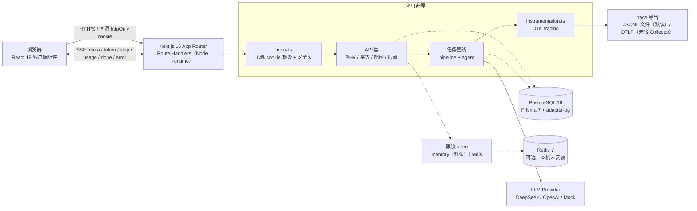
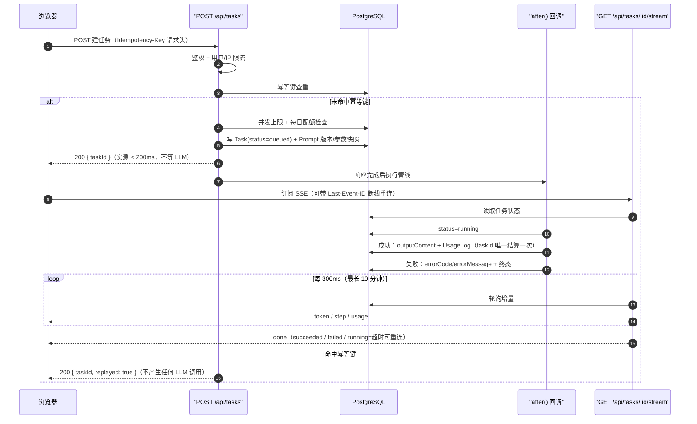
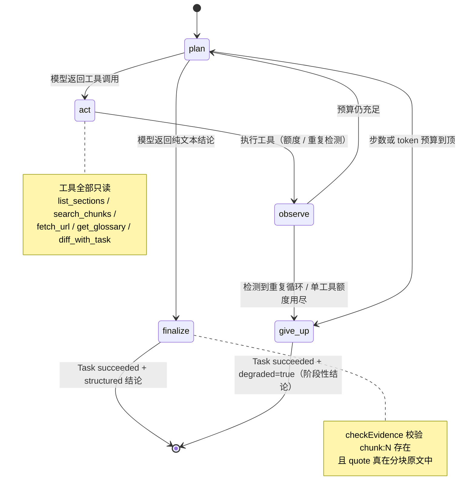
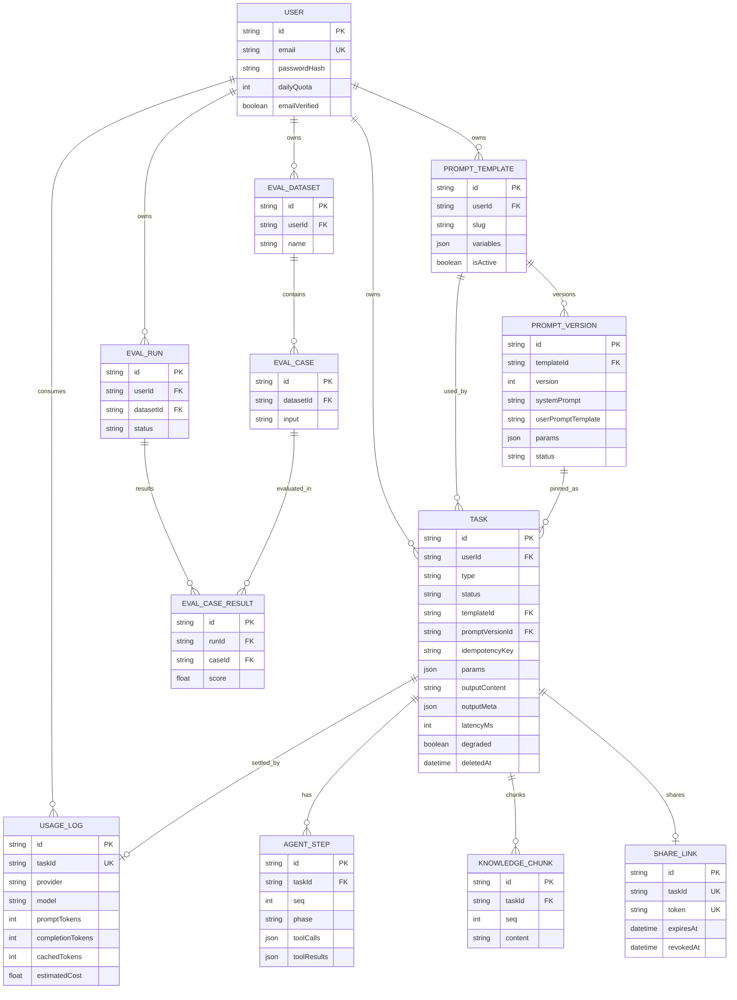
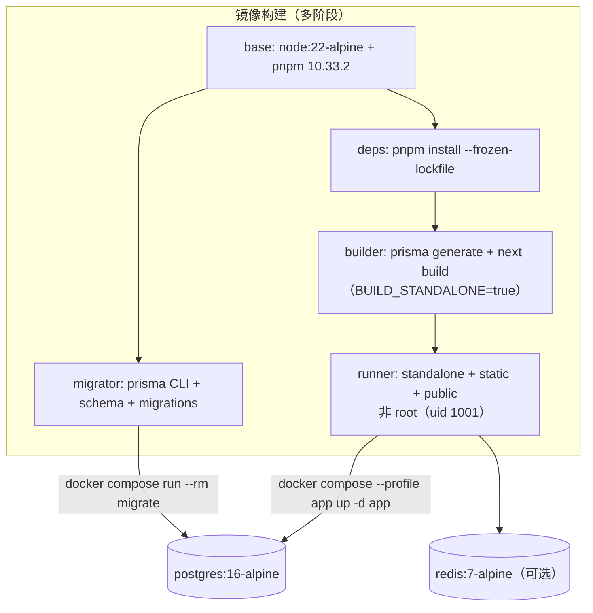

# 架构说明

本文档记录**为什么这样做**，而不是复述代码里已经写了什么。
只写「是什么」的文档没有价值 —— 那些看代码更快。

---

## 目录结构

```
src/
├─ app/
│  ├─ (auth)/login, register      未登录区
│  ├─ (app)/workspace, history, usage   受保护区（服务端 layout 鉴权）
│  └─ api/                        所有 Route Handler，runtime = 'nodejs'
├─ components/                    UI 组件
├─ lib/
│  ├─ llm/                        Provider 抽象 + 重试/熔断/降级 + 计价
│  ├─ pipeline/                   摘要管线（lifecycle / map-reduce / persistence / prompts）
│  ├─ agent/                      Agent 状态机（orchestrator / budget / tool-dispatch / evidence / output / trajectory）
│  ├─ rate-limit/                 限流 store 抽象（memory / redis）与客户端 IP 解析
│  ├─ observability/             OTel tracing、JSONL exporter、指标聚合、脱敏
│  ├─ auth/                      鉴权与越权防护
│  ├─ http/                      SSRF 防护
│  └─ *.ts                       sse / idempotency / markdown 等基础设施
├─ proxy.ts                      路由乐观检查 + 安全响应头（Next 16 文件约定）
├─ instrumentation.ts            可观测性初始化（失败不阻塞启动）
└─ types/api.ts                  前后端共享类型
```

---

## 一、为什么是两段式流式

### 问题

长文摘要在 Serverless 上跑，可能需要几十秒到几分钟。Serverless 有执行时长上限，
一个 HTTP 请求根本撑不住。

### 朴素做法及其问题

在一个请求里直接流式返回。看起来最简单，实际有三个问题：

1. **超时**：超过平台限制就被强杀
2. **断线即丢**：用户切走页面 / 网络抖动，前面生成的token 全部作废
3. **无法重连**：没有可以标识「这个任务」的稳定句柄

### 本项目的做法

```
POST /api/tasks
  ├─ 校验 + 幂等查重（命中则直接返回已有任务，完全不碰 LLM）
  ├─ 创建 Task(status=queued)
  ├─ after() 异步执行管线      ← 关键
  └─ 立即返回 taskId           目标 < 200ms

GET /api/tasks/:id/stream
  ├─ 任务已完成 → 整段回放已落库内容
  ├─ 任务已失败 → 返回错误原因
  └─ 进行中     → 轮询 DB 做增量推送
```

### 三个额外收益

1. **断线可重连**：taskId 是持久化的，重连后服务端知道从哪继续
2. **服务重启不丢**：内容在数据库里，不在内存里
3. **前端能展示进度**：用户看到「正在处理第 3/8 块」，而不是一个转圈

### SSE 协议

五个事件：`meta`（模型与Prompt 版本）/ `token`（增量文本）/ `usage`（token 与成本）/
`done`（终态）/ `error`。

工程细节里最容易踩的两个坑，都在 `src/lib/sse.ts` 里处理了：

- **心跳帧以 `:` 开头**，必须跳过，否则会被解析成空事件
- **`TextDecoder` 必须用 `{ stream: true }`**，否则中文/emoji 跨 chunk 边界时会被截断成乱码
- 还要发 `X-Accel-Buffering: no` 与 `Cache-Control: no-cache, no-transform`，
  否则 Nginx 会缓冲整个响应，流式效果完全消失

---

## 二、Provider 抽象与降级链

### 接口

`LLMProvider` 定义在 `src/lib/llm/types.ts`，只有四个方法：
`generate` / `stream` / `isAvailable` / capabilities。

刻意做得很薄 —— 抽象层越薄，越容易在厂商特性变化时绕过它直接修适配器。
抽象层太厚的结果通常是：所有厂商都被迫实现它们用不上的方法。

### 降级链

```
MOCK_LLM=true 时只有 MockProvider（本地模拟流式，不联网，不产生费用）
真实模式：
  deepseek-flash
    → deepseek-v4-pro      同厂商内降级，语义差异最小
      → openai            跨厂商兜底（配了 OPENAI_API_KEY 才进入链）
        → heuristicSummary 本地启发式，永远不会返回空白
```

**关键设计：降级结果被明确标记（`degraded: true`）。**

不标记等于欺骗用户 —— 用户以为拿到的是模型的输出，其实是本地字符串拼接。
一旦发生降级却没告知，产品的可信度就毁了。

### 可靠性四层

| 层 | 位置 | 作用 |
|---|---|---|
| 重试 | `retry.ts` | 仅 retryable 错误（429/5xx/超时），指数退避 + **全抖动** |
| 熔断 | `breaker.ts` | 连续失败则快速失败，避免持续拖慢响应 |
| 降级 | `service.ts` | 换模型/换厂商/换策略 |
| 兜底 | `budget.ts` | 本地启发式，保证用户永不看到空白 |

**为什么用全抖动而不是固定指数退避？**

固定退避（2s/4s/8s）会让所有被限流的客户端在同一时刻一起重试，形成第二波脉冲，
把刚恢复的服务再次打挂。全抖动 `random(0, min(cap, base*2^n))` 把请求摊平到整个窗口。

**熔断器的一个诚实说明**：状态存在进程内存里，Serverless 多实例下不共享。
单实例部署没问题，多实例必须换Redis。这不是疏忽，是在当前部署形态下的合理取舍。

---

## 三、成本：三个维度都要算

DeepSeek 的计价有三个维度，漏算任何一个账单都会偏：

1. **缓存分档**：flash 的 cache hit 是 miss 的 **1/50**（$0.003 vs $0.15）
2. **峰谷分时**：高峰（工作日北京时间 09:00-12:00 / 18:00-23:00）为低谷的 **2 倍**
3. **输入输出不同价**：输出约为输入 miss 的 **4 倍**

### 因此有两个设计决定

**决定一：稳定内容必须前置。**
`render.ts` 把 system prompt（模板的一部分，不随用户输入变化）放在最前，
用户正文放后面。这不是风格问题 —— **前缀不一致就不命中缓存，成本差 50 倍。**

**决定二：Map 阶段输出要控预算。**
分块 Map 的输出只是中间产物，用户看不到，却同样计费。
`planMapBudget` 在超预算时降低粒度，而不是报错。

### 两个容易算错的地方（已有测试锁定）

- `cachedTokens > promptTokens` 时必须夹紧。上游偶发会报出更大的值，不夹紧会算出负成本
- **未知模型不能按 0 计**。按 0 计会让成本仪表盘显示「几乎免费」——
  这是最危险的失败模式，因为它不会引起任何注意，直到账单出来才发现

---

## 四、安全

### 越权防护：让犯错变得困难

IDOR 的成因几乎总是同一句话：「查的时候忘了带 `userId`」。

靠自觉一定会漏，所以要靠结构：

1. 提供统一的 `authzTask` / `authzShareLink` / `authzTemplate` / `authzGlossaryTerm`
2. 用 `findFirst({ where: { id, userId } })` 而非 `findUnique` + 事后比对 ——
   前者在 SQL 层就过滤掉不属于你的行
3. **查不到或无权时返回 404 而非 403** —— 区分二者会泄漏资源是否存在

> 代码审查规则：禁止出现裸的 `prisma.task.findUnique({ where: { id } })`

### SSRF：四层 + 逐跳复验

```
协议白名单（只允许 http/https）    ← file:// gopher:// 可直接读本地文件
端口白名单（只允许 80/443）        ← 避免扫内网高位端口
主机白名单（配置了就生效）
DNS 解析后校验 IP 是否私网          ← 关键
重定向逐跳复验                     ← 防 302 到内网
```

**最容易做错的是 DNS Rebinding 防护。**
朴素做法「先 resolve 检查是公网，再交给 fetch 二次解析」是可绕过的：
攻击者控制的 DNS 第一次返回公网 IP（通过检查），第二次返回 `127.0.0.1`。

正确做法是**只解析一次，用校验过的 IP 发起请求**（`validateUrl` 返回 `addresses`，由调用方复用）。

**私网判断必须用整数区间比较，不能用「以 10. 开头」这种字符串前缀。**
`010.0.0.1`、`127.000.000.001`、`::ffff:127.0.0.1` 都能指向内网，
字符串匹配一个都拦不住，解析为整数后都会落进正确区间。

### Prompt 注入：诚实承认没有彻底解法

防御是分层的：

- 分隔符包裹，并**转义用户自带的结束标签**（否则攻击者自己闭合边界）
- 输入侧限制长度、去除零宽字符（可用于隐藏指令）
- 输出侧正则脱敏（API Key、身份证、银行卡）
- **给模型的工具全部只读**

但要诚实：**prompt 注入没有「彻底」的解法**。
护栏只降低概率，真正的防线是「不给模型写权限」+「数据隔离」。

另外刻意**不做**「检测到 injection 关键词就拒绝」——
讨论安全话题的正常文档满是这类词，拒绝它们是误伤。

---

## 五、分页：为什么不用 offset

offset 分页有三个会导致**错误数据**（不只是慢）的原因：

1. **深翻页性能退化**：`OFFSET 50000` 要求数据库扫描并丢弃前 5 万行
2. **新插入导致重复/遗漏**（最要命）：用户翻到第 2 页时来了新任务，
   第 1 页的条目被挤到第 2 页，于是同一条出现两次，或某条永远看不到
3. **翻页期间数据被删除**，页码整体前移，出现空洞

keyset 分页用「上一页最后一条的 `(createdAt, id)`」作为游标，
定位 O(log n) 且不受新数据影响。

**为什么用复合游标而不是只用 `createdAt`？**
多条记录可能 `createdAt` 完全相同（同一毫秒创建），
此时必须靠 `id` 做 tie-breaker 才能保证不重不漏。

代价是不能跳页 —— 但历史记录场景里跳页需求很弱，这笔交换非常划算。

---

## 六、Map-Reduce 摘要

```
分块（段落 → 句子 → 硬切）
  ↓
并发 Map（不推流）           ← 中间产物用户不需要看
  ↓
Reduce（流式推给用户）
```

**为什么 Map 不推流？**
用户要的是最终摘要，不是「正在处理第 3 块」。
把中间产物推给他只会造成噪音，还会让前端渲染压力变大。

**分块为什么要三级切？**
只按段落切，遇到超长段落（比如没有空行的复制粘贴）会失效；
只按字符硬切，会把句子拦腰截断，摘要质量明显下降。
三级递进保证「正常文本按语义边界切，异常文本至少不丢内容」。

分块的核心不变量是**每块不超过 `maxTokens`**，
以及**切分不丢内容**。后者由 `tests/chunk.test.ts` 用带序号的标记文本锁定。

---

## 七、鉴权

自建 JWT + refresh 轮换：

```
access token  15 分钟  httpOnly cookie
refresh token  7 天    httpOnly cookie，服务端存哈希并轮换
```

- **登出必须让 refresh token 服务端失效**，而不只是清 cookie ——
  否则 cookie 被窃取后仍可继续换取 access token
- **refresh 时轮换**：每次刷新都删旧建新（事务内），
  旧 refresh token 立即不可用，可检测 token 重放

### 登录接口的两个细节

1. **统一错误文案**：「用户不存在」与「密码错误」必须返回完全相同的提示，
   否则攻击者可以用这个接口判断哪些邮箱注册过本站
2. **假比对消除时间差**：用户不存在时也跑一次 bcrypt，
   让响应时间与「密码错误」时接近。否则可以用时间差枚举账号

---

## 八、proxy 不是安全边界（Next.js 16 的 middleware→proxy 迁移）

Next.js 16 起，`middleware.ts` 文件约定被标记弃用，新约定是根目录/`src` 下的
`proxy.ts`；并且 **Proxy 固定运行在 Node.js runtime**，不允许导出 `runtime`。
本项目按 16.4.0 的本地源码核实后迁移，依据与限制见
[src/proxy.ts](../src/proxy.ts) 顶部注释。

迁移后仍然坚持同一个原则：

- **proxy 只做乐观检查**：判断 access cookie 是否存在、是否需要跳登录页；
- **真正的鉴权在每个 API 路由**（`requireUserId` → 验签 → 查 DB）；
- 判据必须两处一致。历史上 proxy 把 refresh cookie 也算作「已登录」，
  与 layout 判据不一致，直接造成 `ERR_TOO_MANY_REDIRECTS` 死循环 ——
  所以现在两处都只看 access cookie。

**proxy 是体验优化，不是安全边界。** 绕过 proxy 直接打 API 就能进去 ——
把安全建立在它上面就是个漏洞。两层都要有，缺一不可。

### CSP 与安全响应头的真实状态

- 安全头集中在 [src/lib/security/headers.ts](../src/lib/security/headers.ts)：`nosniff`、
  `X-Frame-Options: DENY`、`Referrer-Policy`、`Permissions-Policy`；
- HSTS **只在生产**发送，且实际生效依赖反代正确终止 TLS（本仓库无法自证）；
- CSP 目前是 **Report-Only**：违规只打 console、不阻断。`script-src` 含
  `'unsafe-inline'`、没有 nonce —— 原因是 nonce 方案需要读 `headers()`，
  会把整站从静态渲染变成动态渲染、让 CDN 缓存失效，这属于架构级变更，
  不该混在「补安全头」里悄悄做。收紧到 Enforce 的前提写在 headers.ts 注释里；
- 重定向响应也会带安全头（旧实现只给放行响应加），使「所有出站响应都有安全头」
  成为可测试的不变式（`tests/security-headers.test.ts`）。

> 诚实声明：这**不是一次安全审计**。CSP 未 enforce、proxy 不是边界、HSTS 依赖部署形态，
> 这些都在「已知限制」里明说。

---

## 九、系统架构（验证过的部署形态）



要点：

- **单实例部署**（Docker Compose 或 standalone）下 `after()` 是单机异步执行；
  Serverless 只适合短任务，多实例**没有**队列/租约/全局重试（见 ADR-0005）；
- Redis 只在 `RATE_LIMIT_DRIVER=redis` 时参与，**本机未安装**，真实连通性未验证；
- OTLP 导出代码存在，但本环境没有 Collector，端到端未验证；默认 JSONL 落盘
  `.lumenote-data/traces/`（已 gitignore）。

---

## 十、创建任务 → after() → SSE 时序



**必须一起讲的边界**：

- 状态机是 `queued → running → succeeded / failed`；`canceled` 目前**不可达**
  （没有对外取消接口，`after()` 未传 `AbortSignal`）；
- 管线**只在终态写 `outputContent`**，执行中不落增量 —— 崩溃后已生成内容会丢失（ADR-0005 承认）；
- 幂等只防「同一个 key」，客户端每次点生成都是新 key，所以还要靠并发上限；
- SSE 的 Mock 兜底执行（原子抢占 `queued → running`）是演示手段，不是队列。

---

## 十一、Agent 状态机与证据链



拆解：

- **控制权在代码**：模型只在 `plan` 阶段决定「调哪个工具 / 给结论」，状态转移由规则决定；
- **双预算**：`maxSteps`（6/12/20）+ `maxTokens`；单工具额度（如 `search_chunks` ≤ 10）；
- **重复检测**：相同工具+相同参数第 2 次提醒、第 3 次由代码强制收敛（不让模型的后续行为
  覆盖 `stopReason`）；
- **`give_up` ≠ `failed`**：到顶时交回阶段性结论并标 degraded，而不是让用户白等白花钱；
- **证据校验是确定性的**：`checkEvidence()` 只判断「引文是否真在 `chunk:N` 里」，
  不需要 LLM judge、零成本。

模块拆分：`loop.ts` 从 968 行降为 **43 行门面**（re-export），职责落到
`orchestrator / budget / tool-dispatch / evidence / output / trajectory / types`，
依赖单向。行为不变由 characterization tests 锁定。

---

## 十二、核心数据模型



四个「可追溯」相关的约束（字段名以 [prisma/schema.prisma](../prisma/schema.prisma) 为准）：

1. `Task.promptVersionId` + `Task.params` 是**创建时快照**，改 Prompt/术语表不改变历史；
2. `UsageLog.taskId @unique` 是「一个任务只结算一次」的数据库级幂等；
3. `Task @@unique([userId, idempotencyKey])` 是防重复建任务的最终防线；
4. `AgentStep @@unique([taskId, seq])` 保证轨迹回放可信（第 3 步出现两次，回放就是错的）。

---

## 十三、限流：双驱动与多实例边界

旧实现是「进程内存 Map + 同步函数」，只能做每实例限流。现在把计数后端抽象成
`RateLimitStore`（[src/lib/rate-limit/](../src/lib/rate-limit/)）：

- `memory`（默认）：本地/单实例，以及 Redis 故障时的降级目标；
- `redis`：Lua 原子 `INCR + PEXPIRE` 计数，多实例共享；
- `RATE_LIMIT_FAIL_MODE=open|closed`：Redis 故障时回退内存（可用性优先）
  或直接 429（安全优先），两种都不把异常冒到业务层；
- `TRUST_PROXY_HOPS`：默认 0，**不信任任何 `X-Forwarded-For`**（所有请求共享 `unknown` 桶，
  防伪造但无法区分客户端）；部署在反代后必须按层数配置，且应用端口只对代理开放。

**多实例边界必须诚实**：限流计数可以共享，但 **LLM 熔断器仍是进程内存**
（[src/lib/llm/breaker.ts](../src/lib/llm/breaker.ts)），多实例下各实例独立打开熔断。
不要把它讲成完整的分布式可靠性方案。

验证状态：memory driver 与 fake Redis client 有单测；`pnpm test:redis` 在本机输出
`SKIPPED`（退出码 2，无 Redis）；真实 Redis 只在 CI 的 `rate-limit-redis` job 中配置，
而该 job **从未在 GitHub 实际运行过**（仓库没有 remote）。

---

## 十四、可观测性

- `src/instrumentation.ts` 初始化 OTel，**任何失败只 warn、不阻塞启动**；
- span 命名即查询接口：`task.pipeline / task.lifecycle / task.persist / llm.request /
  agent.plan / agent.tool / agent.observe / agent.finalize / agent.evidence_check`；
- `taskId` 通过 OTel Context（AsyncLocalStorage）贯穿，**不用全局变量** ——
  Next 并发处理多个任务，全局变量会把 A 任务的 taskId 写到 B 任务的 span 上；
- 默认 JSONL 导出到 `.lumenote-data/traces/`（gitignore），`TRACE_EXPORT=otlp` 需自备 Collector；
- 生产默认关闭：trace 落盘会产生磁盘 IO 与用户内容的本地副本（已脱敏），应由运维显式开启；
- 脱敏：不落 API Key / 完整 prompt / 文档正文，只留长度与哈希，另有属性键黑名单与
  `sk-...` 值级兜底（[src/lib/observability/sanitize.ts](../src/lib/observability/sanitize.ts)）；
- 指标聚合 `src/lib/observability/metrics.ts` 直接从数据库查询 p50/p95、token/成本、
  工具失败率、证据完整率、失败/超时率，口径写在 `METRIC_DEFINITIONS`。

**未验证**：OTLP 端到端（无 Collector）；trace 只验证过 JSONL 落盘与 span 结构。

---

## 十五、测试体系：单测、集成、覆盖率

| 层 | 命令 | 覆盖什么 | 环境要求 |
|---|---|---|---|
| 单测 | `pnpm test` | 纯逻辑：分块/计价/SSRF/护栏/重试/渲染/模板/加解密/限流 store/observability | 无（不连库、不联网） |
| 集成 | `pnpm test:integration` | 真实 Postgres + 真实 HTTP：空库迁移、seed 幂等、越权、幂等键、配额、状态机、SSE 重连、Agent、追问、分享 | 需 PostgreSQL 16 的测试库（harness 会 DROP schema 后迁移 + seed + 起 `next dev`） |
| 覆盖率 | `pnpm test:coverage` | **只统计 `src/lib/**` 的纯逻辑**，不代表整体验证程度 | 无 |

集成测试的关键设计（[tests/integration/global-setup.ts](../tests/integration/global-setup.ts)）：

- 被测应用用 `next dev` 真跑，而不是 mock 掉路由：两段式/SSE 的坑全在跨请求生命周期里；
- `TRUST_PROXY_HOPS=1` + 每个测试用户独占 `X-Forwarded-For`，避免注册限流互相挤占；
- **同一 worktree 同时只能有一个 `next dev`**（Next 16 有「Another next dev server is already
  running」的 per-project 锁）—— 所以跑集成测试前要先停掉 `pnpm dev`；
- 集成测试会 **DROP `DATABASE_URL` 指向库的 public schema**，必须指向测试库，
  绝不要指向开发库。

覆盖率现状（2026-10-20 实测，31 文件 / 656 单测）：

```
All files | statements 40.67 | branches 82.81 | functions 72.22 | lines 40.67
```

`vitest.config.ts` 的防倒退阈值是 36 / 83 / 70 / 36 —— **branches 82.81% 低于 83% 阈值，
当前 `pnpm test:coverage` 退出码 1**。这是一个真实的红灯：本仓库没有为了让数字好看
去调低阈值，也没有把它藏起来（详见 README 的验证状态表）。

---

## 十六、部署链路与验证状态

部署设计（[Dockerfile](../Dockerfile) + [docker-compose.yml](../docker-compose.yml)）：



三步启动（迁移只执行一次，不在 app entrypoint 里）：

```bash
docker compose up -d postgres redis     # 1. 依赖就绪（healthcheck）
docker compose run --rm migrate         # 2. 一次性迁移，非 0 退出则中止
docker compose --profile app up -d app  # 3. 启动应用（只连库，不碰 schema）
```

**⚠️ 本环境没有安装 Docker**：`docker build` / `docker compose config` / `docker run`
**均未运行**。替代验证是 standalone 产物按镜像同款布局启动 `node server.js`（20/20 断言，
`/api/health` 200 且 `db.ok=true`）+ PyYAML 静态校验（51/51 项）。详见
[ADR-0005](adr/0005-async-execution-boundary.md) 的「验证」一节。
